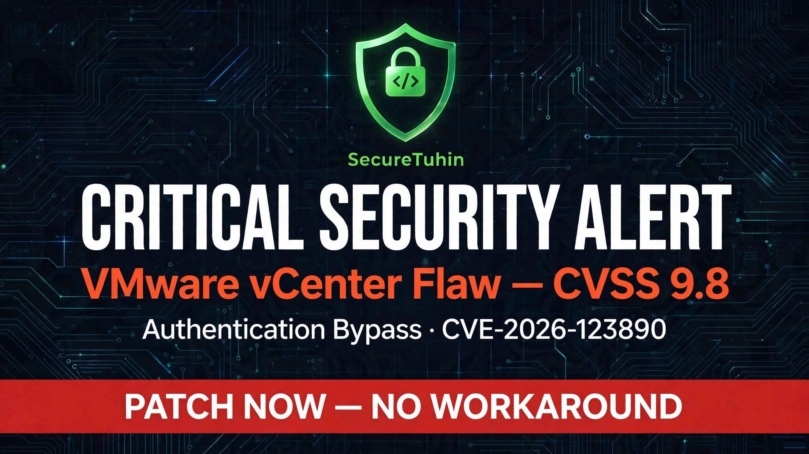

# 🚨 Critical Security Alert — VMware vCenter (CVSS 9.8)

**CVE-2026-123890 — Authentication Bypass**

A critical vulnerability in VMware vCenter lets an attacker with network access bypass authentication entirely — no password needed — and take control of every virtual server managed by vCenter.

## Affected versions
- vCenter 8.0
- vCenter 9.0
- vCenter 9.1

## What admins must do
- ✅ Apply Broadcom's official patch **immediately** — there is **no workaround**
- 🔒 Until patched, keep vCenter off the public internet
- 🔍 Review vCenter access logs for suspicious sign-ins

## Source
The Hacker News: https://thehackernews.com/2026/11/critical-vmware-vcenter-flaw-cvss-98.html

---
🛡️ *Security awareness by **SecureTuhin** | Ethical Hacking Bangla — a CodeTuhin initiative.*
💻 Web development & security: [CodeTuhin](https://github.com/codetuhinbd) · Telegram: https://t.me/securetuhin · Channel: https://t.me/codetuhin_channel
